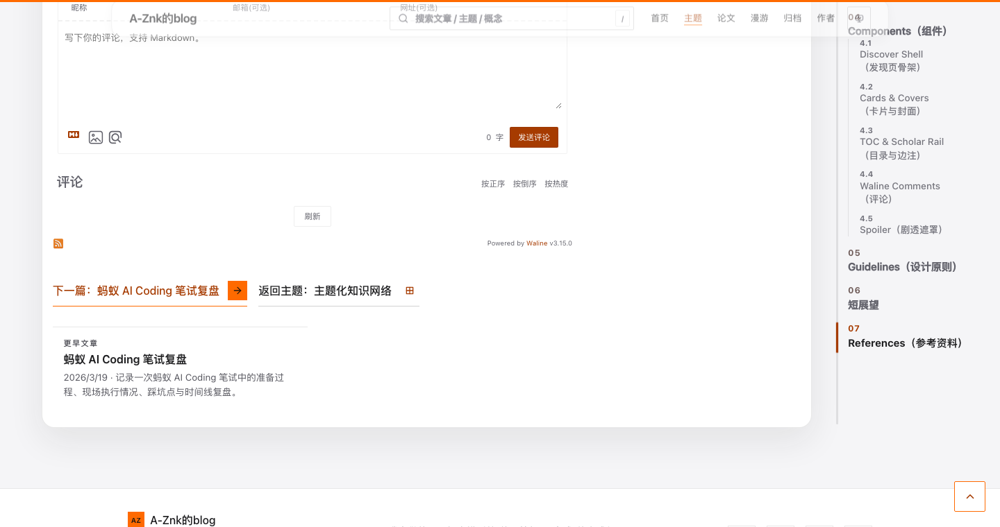

# 文章目录平滑跟随 · 2026-10-24

## 修复动机

读者滚动长文章时，目录内部原先以 `scrollTop += delta` 瞬间调整，且临时关闭橙色指示条的过渡，造成突跳。

## 实现与验收

- 仅在激活章节变更、真实窗口几何改变或折叠重新展开时发起目录自身的原生 smooth scroll。Header 状态变化只重算进度条，不重启目录动画。
- 目录滚动事件持续更新橙色指示条的位置，保留平滑过渡。减少动画模式则即时定位。
- 基于最新中英双语+Agent工作台主线：`pnpm test` 159/159；目录相关 Playwright 17/17（含 `/en/posts/myblog-design-manual`），Mac mini 独立生产构建。
- 截图 `toc-smooth-1440x760-after.png`：长文 `myblog-design-manual` 最后一节 References，目录内部 scrollTop 410，marker 与当前链接底边误差 3.41px，1440px 视口无横向溢出。

## 截图

