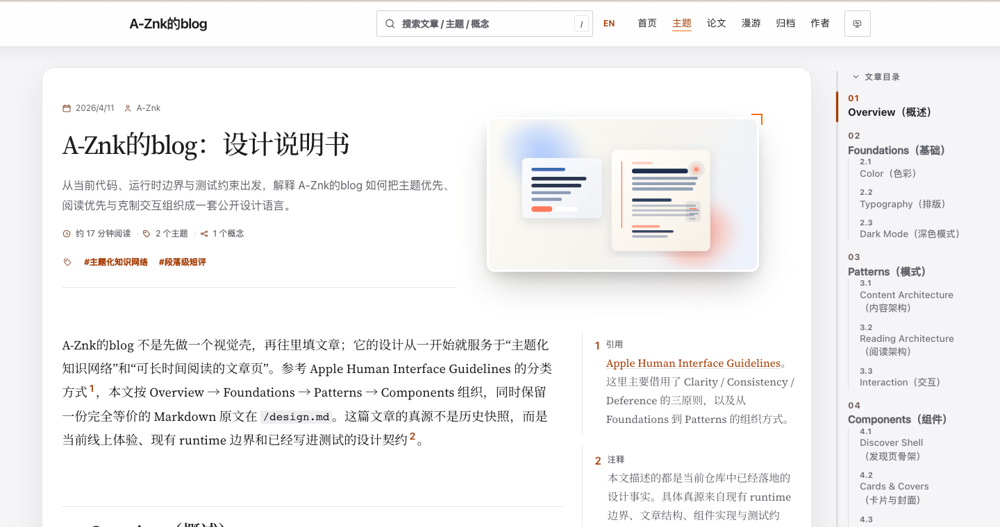
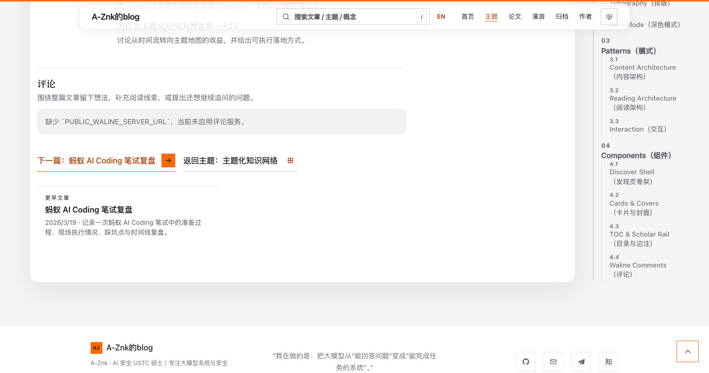
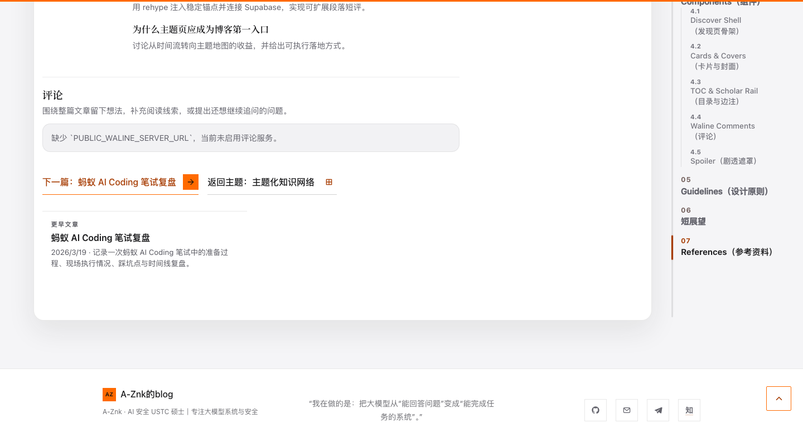
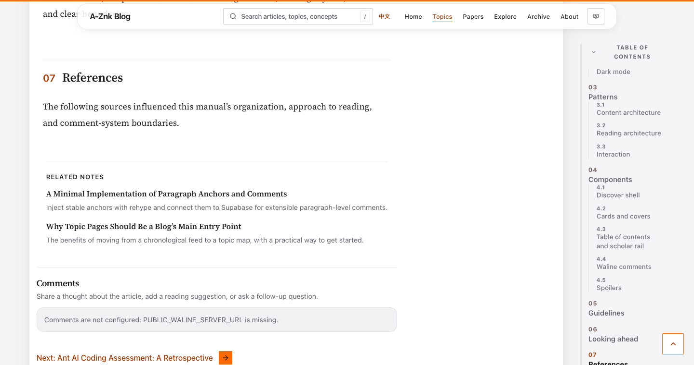
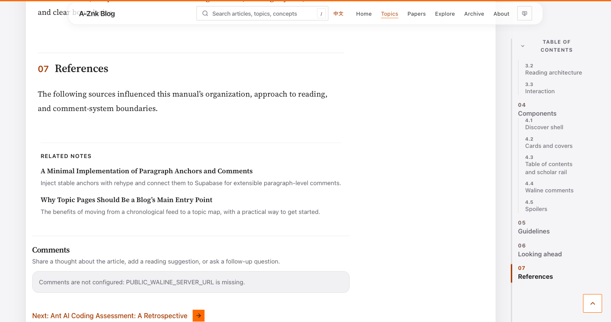

# 文章目录帧限速跟随 · 2026-10-25

## 动机和根因

用户反馈目录仍在突然跳动。第一轮修复（PR #50）只把直接改变 `scrollTop` 替换为浏览器原生 `scrollTo({ behavior: "smooth" })`，但这种定时动画在浏览器主线程负载高、渲染帧跳过时仍会出现大幅位移。新增行为测试在上一版录得中文一次 286px、英文 136px 的目录滚动增量，先红后绿。

## 新机制

- 每个目录容器最多一个 rAF 跟随动画；新的章节更新同一目标，不会启动竞争动画。
- 每个实际渲染帧写入的 `scrollTop` 增量绝对值最多 24px；不依赖墙钟时间计算前进量。检测不可滚动状态，限制最长动画帧数，页面卸载时清理。
- 快速远距离跳转时橙色进度条 90ms 淡出，到位后通过既有 320ms 过渡恢复，避免进度条瞬间横跨目录。
- 用户手动滚动、触摸或点击目录时取消自动动画；减少动画模式直接定位。
- 保留正文位置、章节计算、原先舒适阅读区、折叠状态、手机原生目录和中英两个版本的锚点。

## 验证

- Mac mini 完整 Astro build：40 页完成；单元测试 164/164；19 对中英译文及索引检查通过。
- 目录相关 Playwright 20/20：两套引擎的双语跳转、快速折返、600/760/1000px短窗口、手机、折叠展开与锚点回归。
- 双语 Chromium + WebKit 四组真实浏览器跟随轨迹：最大单次 scroll 增量均为 24px；中文最终目录位移 Chromium 410px/WebKit 433px，英文 Chromium 314px/WebKit 298px；全部最终显示当前末节，标记恢复且无 JavaScript 错误。
- 1440×760 最终截屏：Chromium 中文橙色标记与当前链接底边误差 3.41px，WebKit 英文 4.06px，两者水平溢出均为 0。低帧率设备的效果仍以真实设备手动感受为最终判定。
- 截图和详情见 `final-visual-metrics.json`；正式部署验收状态以 PR/生产检查为准。

